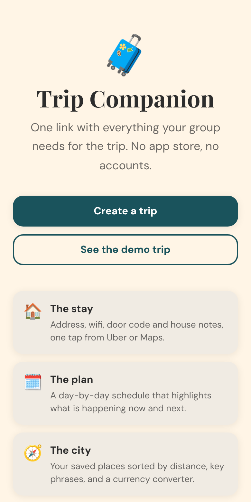
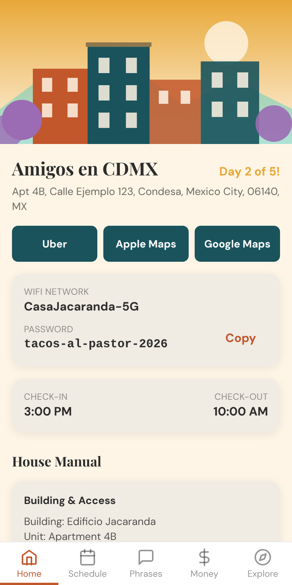
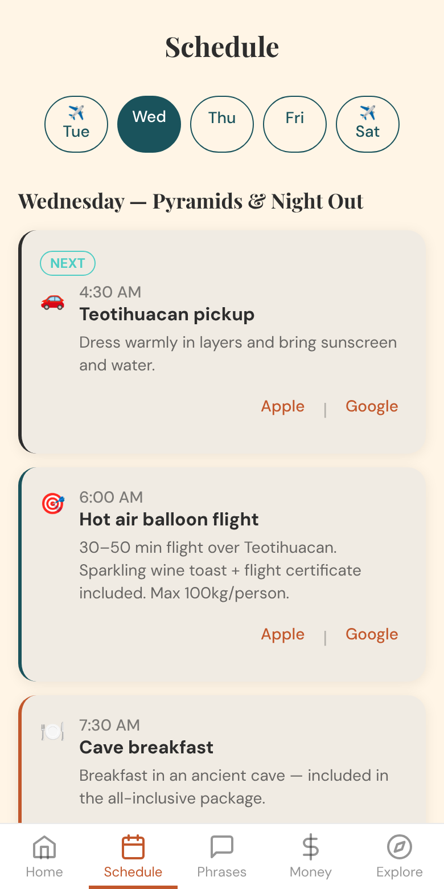
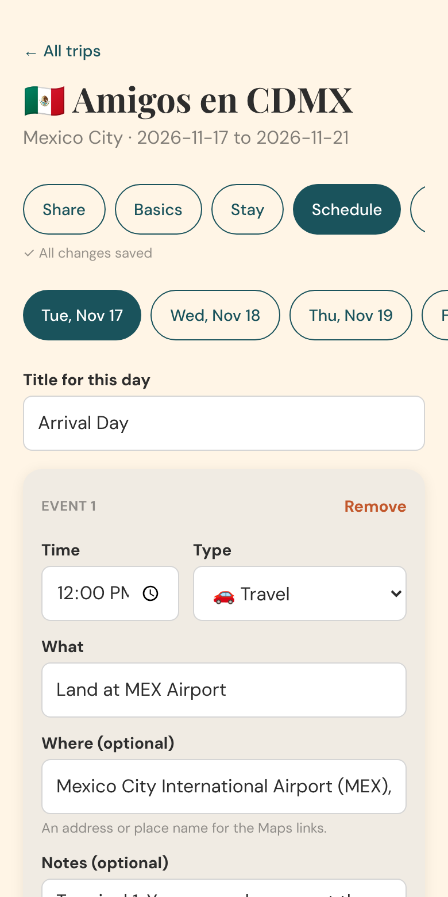
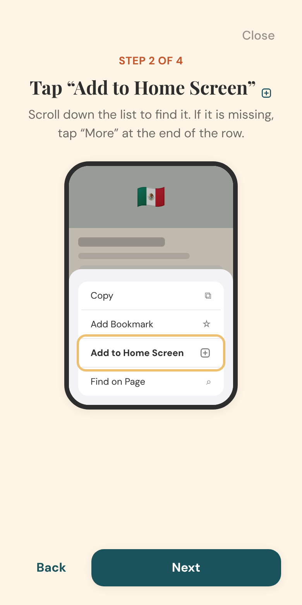

# Trip Companion

One link with everything your group needs for a trip: where you're staying, the plan for each day, places worth going, a few key phrases, and a currency converter. Guests open the link and add it to their home screen. There is no app store and nobody creates an account.

It started as a hand-built page for one family trip to Mexico City. This is the version anyone can use.

<p>
  
  
  
  
  
</p>

## How it works

1. **Create a trip.** Enter a name, destination and dates. Currency and phrase-book language are suggested from the destination.
2. **Get two links.** A *guest link* for the group chat, and a private *edit link* for you.
3. **Fill it in.** The edit link opens an editor for the stay, schedule, places and phrases. Changes save as you type.
4. **Guests install it.** The first time someone opens the guest link on a phone, they are walked through adding it to their home screen. After that it works offline.

### What guests get

| Tab | What it does |
| --- | --- |
| **Home** | Address with Uber / Apple Maps / Google Maps buttons, wifi with tap-to-copy, check-in times, house manual |
| **Schedule** | Day-by-day plan; today is preselected and the current and next events are flagged |
| **Phrases** | Phrase book grouped by topic, with tap-to-hear pronunciation |
| **Money** | Live exchange rate and a two-way converter |
| **Explore** | Saved places, sorted by distance from where you are standing |

### No accounts

The edit link *is* the credential: it contains a long random key, and whoever has the link can edit. The server stores only a hash of it. The browser that created a trip remembers it under "Your trips"; from any other device you need the edit link, and if it is lost there is no recovery. That trade keeps the whole thing free of sign-ups, passwords and email.

Organizers can also set a **guest passcode**. Without it, anyone holding the guest link can read the trip, so set one before adding a door code.

Trips are **deleted automatically 30 days after their end date**.

### Languages

The interface comes in English, Spanish, French, German and Portuguese. A visitor's language is taken from their browser and can be changed from the corner of the landing page; a trip then keeps its organizer's language, so guests see it that way too. The starter phrase book pairs that language with the destination's (French → Portuguese, say).

To add a language, copy `shared/i18n/es.js`, translate the values, and list it in `shared/i18n/index.js`. `npm test` fails if any string in the app is missing from a catalog.

## Run it locally

```bash
npm install
```

```bash
npm run dev
```

Open the printed URL. With no database configured, trips are saved to `.data/store.json`, so everything works with zero setup. `/demo` shows a sample trip.

## Deploy your own

The app is a static Vite build plus two small serverless functions, set up for Vercel.

[](https://vercel.com/new/clone?repository-url=https://github.com/samshaps/trip-companion)

1. Deploy the repository to Vercel (the button above, or import it from the dashboard).
2. In the project's **Storage** tab, add **Upstash for Redis** from the Marketplace and connect it to the project. The free plan is plenty.
3. Redeploy so the functions pick up the new environment variables.

That is all the configuration there is. The functions read `KV_REST_API_URL` and `KV_REST_API_TOKEN` (or `UPSTASH_REDIS_REST_URL` and `UPSTASH_REDIS_REST_TOKEN`), which the integration sets for you. Without them, a deployment still serves the landing page and demo, and reports that trips cannot be saved.

## How it's built

```
api/                 Vercel function entry points (two one-liners)
server/
  trips.js           The whole backend: create, read, save, manifest
  store.js           Storage: Upstash Redis in production, a JSON file locally
shared/
  tripSchema.js      The trip document: shape, limits, validation, defaults
src/
  App.jsx            Five routes, no router library
  pages/             Landing, create, organizer editor, guest view, the five tabs
  components/        Trip shell, editor sections, install walkthrough
  lib/               API client, routing, offline cache
  data/              The bundled demo trip
qa/                  Scripted, video-recorded walkthroughs of every user story
tests/               Unit tests for the schema and the API
```

A trip is a single JSON document (about 50 KB for a full one) stored under its id. `shared/tripSchema.js` validates and bounds every document on its way in, and both the editor and the server use it.

A few decisions worth knowing about:

- **Offline first for guests.** The last copy of a trip is kept on the device and shown instantly; the server is only asked for something newer.
- **Each trip has its own web app manifest**, so "Add to Home Screen" installs that trip by name instead of the landing page.
- **Map pins are pasted, not geocoded.** The editor pulls coordinates out of a Google Maps link, so no geocoding service or API key is involved.
- **No photo uploads.** The stay photo is a link to an image hosted elsewhere, which keeps storage tiny.
- **Abuse limits.** Trip creation and passcode attempts are rate limited per IP address, and documents are capped in size.

## Checks

```bash
npm test
```

Unit tests for validation, access rules and rate limits.

```bash
npm run lint
```

```bash
npm run qa
```

`npm run qa` drives a phone-sized browser through every user story (creating a trip, editing it, a guest opening it, going offline, the install walkthrough on iPhone and Android) and writes a captioned screen recording and a pass/fail checklist per phase to `qa/output/`. It needs [Playwright](https://playwright.dev) with Chromium and `ffmpeg` installed.

## Limits, on purpose

This is a small project, not a product. There are no accounts, no collaboration between editors beyond sharing the edit link, no image hosting, and no recovery for a lost edit link. If two people edit at once, the last save wins.

## License

[MIT](LICENSE)
